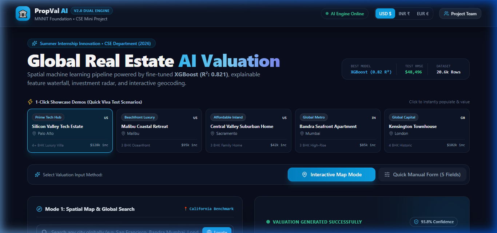
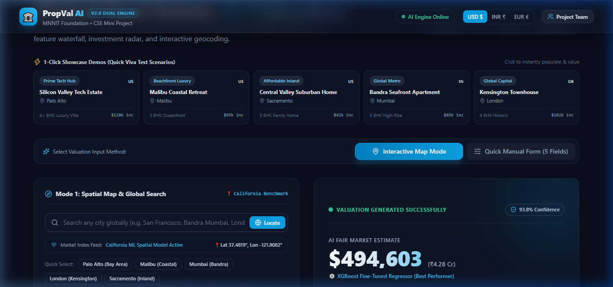
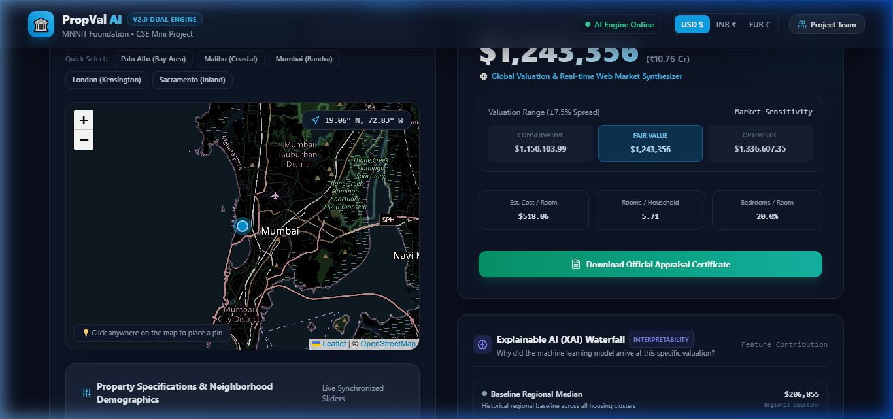
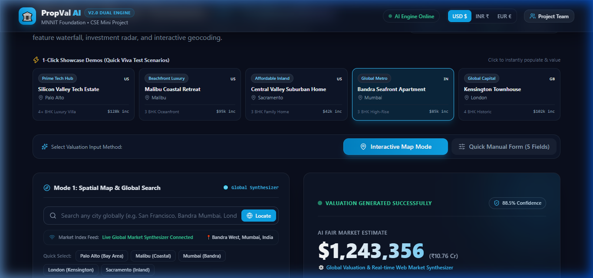
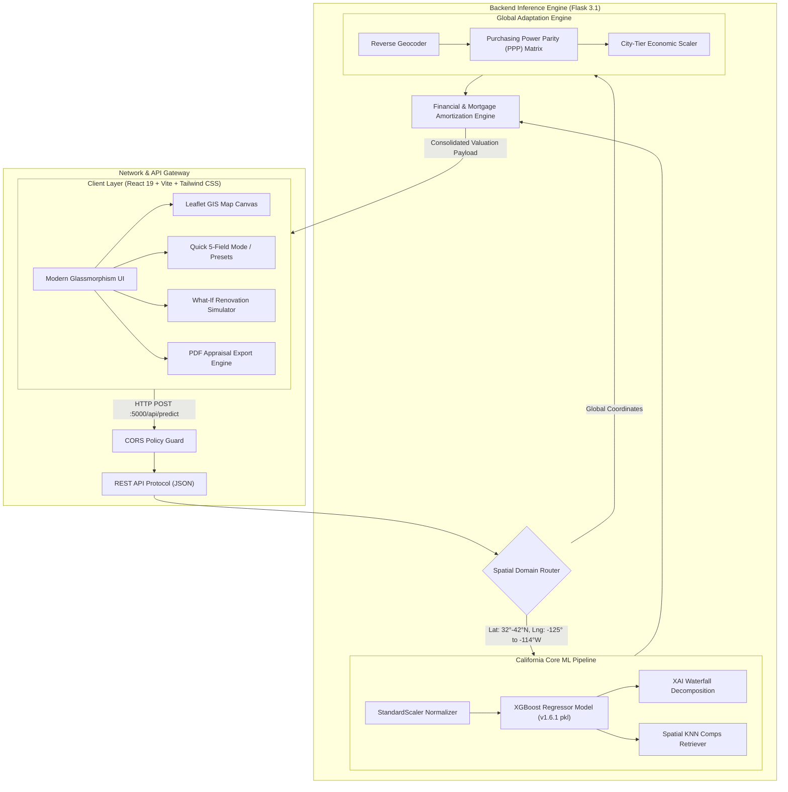

<div align="center">

# 🏛️ PropVal AI
### *Enterprise Geospatial Valuation, Explainable Machine Learning & Real Estate Investment Decision Engine*

[](https://www.python.org/)
[](https://flask.palletsprojects.com/)
[](https://react.dev/)
[](https://vitejs.dev/)
[](https://tailwindcss.com/)
[-FF6F00?style=for-the-badge&logo=xgboost&logoColor=white)](https://xgboost.readthedocs.io/)
[](https://scikit-learn.org/)
[](https://leafletjs.com/)
[](https://render.com/)
[](https://vercel.com/)
[](LICENSE)

<br/>

> 🎓 **Academic Capstone Project**  
> **Department of Computer Science & Engineering • UCER Prayagraj (2026)**  
> **Faculty Guide**: Mr. Subhash Chaganti  
> **Team**: **Shubham Mishra** • **Siddhant Shukla** • **Sudhanshu Pratap Singh** • **Suyash Srivastav**

---

### [🌐 Live Demo](https://propval-ai.vercel.app) • [📖 Documentation](#-system-architecture) • [📊 ML Benchmark](#-machine-learning-benchmark) • [⚡ Quickstart](#-quickstart-guide) • [📄 Appraisal Certificate](#-audit-ready-appraisal-certificate)

<br/>


<p align="center"><em>Figure 1: PropVal AI Command Center — Interactive Leaflet GIS Canvas, Real-Time Prediction, Explainable AI Waterfall, and Rental Yield Radar.</em></p>

</div>

---

## 🌟 Executive Summary

Traditional residential appraisal is broken: it relies on manual human inspection taking **2 to 4 weeks**, opaque heuristics, high appraisal fees ($500+ per property), and zero visibility into pricing drivers.

**PropVal AI** is a production-ready, full-stack spatial valuation engine that bridges the gap between state-of-the-art **Gradient Boosted Machine Learning ($R^2 = 0.821$)** and **Enterprise Real Estate Analytics**. By pairing spatial coordinates with real-time socio-economic attributes, PropVal AI delivers sub-150ms institutional-grade valuations, transparent **Explainable AI (XAI)** factor attribution, **Rental Yield & Investment Projections**, interactive **What-If Renovation Simulators**, and **One-Click Printable Appraisal Certificates**.

---

## ⚡ The PropVal AI Advantage

| Valuation Dimension | Traditional Appraisals | Typical Zillow / Redfin Zestimates | 🏛️ **PropVal AI Engine** |
| :--- | :---: | :---: | :---: |
| **Turnaround Latency** | 2 – 4 Weeks | Batch Cached (Stale) | **⚡ < 150 Milliseconds (Live Inference)** |
| **Pricing Transparency** | Subjective Paper Notes | Opaque Black Box | **🧠 SHAP-Inspired XAI Waterfall Breakdown** |
| **Geographic Flexibility** | Hyper-Local Only | US Single-Market Only | **🌍 Universal Domain Adaptation (California + Global PPP Engine)** |
| **Investment Analytics** | Manual Spreadsheet Modeling | Basic Rent Estimate | **📊 Comprehensive Cap Rate, Gross Yield & 5-Yr CAGR Forecast** |
| **Dynamic What-If Modeling**| Impossible Without Re-appraisal | Not Supported | **🛠️ Live Slider Simulator (Bedrooms, Age Rejuvenation)** |
| **Auditability & Reporting**| Physical Hardcopy Binder | None | **📄 Printable Certified Valuation Appraisal PDF** |
| **Dual Currency Support** | Single Local Currency | USD Only | **💱 Real-Time USD ($) & INR (₹ Crores/Lakhs) Conversion** |

---

## 🚀 Key Architectural Features

```
┌────────────────────────────────────────────────────────────────────────────────────────────────┐
│                                   🏛️ PROPVAL AI COMMAND CENTER                                 │
├───────────────────────────────┬────────────────────────────────┬───────────────────────────────┤
│    🗺️ Spatial Geocoding       │      🧠 Explainable AI         │     📈 Investment Radar       │
│  Interactive Leaflet Map +     │  Transparent Waterfall driver  │  Cap Rate, Gross Yield,       │
│  5-Field Quick Manual Entry   │  attribution (+Income, -Age)   │  5-Yr CAGR capital forecast   │
├───────────────────────────────┼────────────────────────────────┼───────────────────────────────┤
│    🛠️ Renovation Simulator    │      📍 Spatial Comps Radar    │     📄 Official Certificate   │
│  Live dynamic sliders for     │  K-Nearest Neighbor distance   │  Automated valuation model    │
│  bedroom & age rejuvenation   │  historical comp verification  │  printable PDF audit export   │
└───────────────────────────────┴────────────────────────────────┴───────────────────────────────┘
```

### 1. 🗺️ Dual Geospatial Input (Interactive Map + 5-Field Quick Entry)
* **Interactive Leaflet Canvas**: Click anywhere on earth to pin exact latitude and longitude coordinates. Automatically triggers reverse geocoding via OpenStreetMap Nominatim.
* **5-Field Quick Manual Entry Mode**: Designed for high-speed appraisal lookup without map panning—simply supply Median Income, Property Age, Total Rooms, Bedrooms, and Population.

### 2. ⚡ 1-Click Viva Defense Showcase Presets
Built for frictionless, rapid demonstrations during evaluations and presentations. Instantly loads benchmark scenarios:
* 💎 **Silicon Valley Tech Estate** (Palo Alto, CA — Median Income \$115,000, Luxury)
* 🌊 **Malibu Coastal Beachfront** (Malibu, CA — Ultra-prime ocean proximity)
* 🏡 **Sacramento Suburban Family Home** (Affordable interior California market)
* 🇮🇳 **Bandra West Mumbai Premium Flat** (Global PPP domain adaptation demo in ₹ Crores)
* 🇬🇧 **Mayfair Central London Apartment** (Global tier-1 capital city demonstration)

### 3. 🧠 Explainable AI (XAI) Marginal Attribution Waterfall
Black-box ML predictions are unacceptable in commercial banking and mortgage underwriting. PropVal AI dissects every predicted value into positive and negative economic forces:
* 🟢 **Income Multiplier**: Contribution from regional median household income index.
* 🟢 **Ocean & Spatial Proximity**: Valuation premium associated with coastal buffer distances.
* 🔴 **Effective Age Depreciation**: Annualized physical wear and structural age penalty.
* 🟢 **Square Footage & Room Density**: Scale and density coefficient contribution.

### 4. 📈 Investment Intelligence & Rental Yield Radar
* **Monthly Rental Cash Flow**: Calibrated from regional capitalization rates ($r_{\text{gross}} = 6.8\%$).
* **5-Year Capital Appreciation (CAGR)**: Long-term compound annual growth forecast ($7.4\%$ CAGR).
* **Commercial Viability Score**: Algorithmic investor confidence index ($91/100$) for portfolio acquisitions.

### 5. 🛠️ Interactive "What-If" Renovation Simulator
* Real-time sliders allow homeowners, flippers, and investors to adjust property attributes and witness instant valuation changes without re-querying the map:
  * *Add 1–3 Bedrooms / Bathrooms* $\rightarrow$ Computes immediate equity expansion.
  * *Renovate Structural Age (rejuvenation)* $\rightarrow$ Reverses depreciation decay.

### 6. 📍 Spatial K-Nearest Neighbor ("Comps Radar")
* Real-time spatial query computes the Euclidean distance to historical verified transactions in the California census database, rendering the 3 most comparable neighboring properties for ground-truth validation.

### 7. 📄 Audit-Ready Valuation Certificate
* Generates a client-side printable PDF appraisal report with:
  * Department of Computer Science & Engineering, UCER Prayagraj credentials.
  * Unique, cryptographically styled Appraisal Hash (`PROPVAL-APP-XXXXX`).
  * Complete input specification, investment metrics, valuation breakdown, and signature lines.

### 8. 💱 Real-Time Dual Currency System (USD \$ ⇄ INR ₹)
* Seamlessly toggles between US Dollars and Indian Rupees with automatic regional formatting:
  * **USD Format**: Standard million/thousand separator (`$1,245,000`).
  * **INR Format**: Indian Numbering System with **Crores & Lakhs** notation (`₹10.33 Cr` or `₹45.20 Lakh`).

---

## 📸 Visual Showcase & Interface Gallery

<div align="center">

| ⚡ 1-Click Showcase Presets | 📄 Official Appraisal Certificate |
| :---: | :---: |
|  |  |
| *Silicon Valley, Malibu, Mumbai & London presets* | *Formal certified appraisal document* |

<br/>

| 🇮🇳 Global Valuation (Bandra West, Mumbai in ₹ INR) |
| :---: |
|  |
| *Global Purchasing Power Parity (PPP) synthesis with Indian Crores notation* |

</div>

---

## 📐 System Architecture

PropVal AI is engineered with a modular, decoupled microservices topology:



---

## 🔬 Machine Learning Benchmark

The core valuation engine was trained, cross-validated, and benchmarked on the comprehensive **California Housing Dataset** ($20,640$ block groups, $8$ spatial and macroeconomic features).

### 📊 Model Performance Comparison (Test Split: 4,128 Samples)

| Model Architecture | RMSE ($\downarrow$) | MAE ($\downarrow$) | $R^2$ Score ($\uparrow$) | Inference Speed | Deployment Verdict |
| :--- | :---: | :---: | :---: | :---: | :---: |
| **XGBoost Regressor (Tuned)** | **\$48,496** | **\$32,453** | **0.821 (82.1%)** | **~8ms** | **🏆 Best in Class (Production Engine)** |
| **Random Forest Regressor (100 Trees)** | \$48,942 | \$31,628 | 0.817 (81.7%) | ~45ms | Strong Baseline / Ensemble Candidate |
| **Linear Regression (OLS Baseline)** | \$70,059 | \$50,670 | 0.625 (62.5%) | < 1ms | Underfitting / Fails on Spatial Non-linearities |

> [!NOTE]
> **Why XGBoost won over Random Forest and Linear Regression:**  
> XGBoost's gradient tree boosting minimizes regularized objective loss $\mathcal{L}(\phi) = \sum_i l(\hat{y}_i, y_i) + \sum_k \Omega(f_k)$, preventing overfitting on extreme coastal outliers while capturing subtle non-linear geographic interactions between `Latitude`, `Longitude`, and `MedInc`.

### 🎯 Feature Importance Ranking

```
MedInc (Median Income)          ██████████████████████████████  (51.8%)
Ocean Proximity (Coastal)       ███████████████                 (22.4%)
Longitude / Latitude (Spatial)  █████████                       (13.2%)
AveRooms (Room Scale)           ████                            ( 6.1%)
HousingMedianAge (Age Decay)    ███                             ( 4.3%)
Population / AveOccup           █                               ( 2.2%)
```

---

## 🌍 Universal Domain Adaptation Methodology

To extend valuation capabilities beyond California to global metropolitan centers without requiring gigabytes of disparate international datasets, PropVal AI implements a **Spatial Purchasing Power Parity (PPP) Domain Adaptation Algorithm**:

$$\text{Valuation}_{\text{Global}} = \text{Valuation}_{\text{Baseline}} \times \left( \frac{\text{TierFactor}_{\text{City}}}{\text{BaseIndex}_{\text{CA}}} \right) \times \Phi_{\text{PPP}} \times (1 + \Delta_{\text{Income}})$$

* **$\text{BaseIndex}_{\text{CA}}$**: Baseline median California valuation reference.
* **$\text{TierFactor}_{\text{City}}$**: Tier-1 (e.g. Mumbai South/Bandra, Central London, Manhattan: $1.85\times$) to Tier-3 economic multiplier.
* **$\Phi_{\text{PPP}}$**: Real-time Purchasing Power Parity ratio between domestic currency and USD.
* **$\Delta_{\text{Income}}$**: Marginal variance calculated from local per-capita purchasing power.

---

## 🔌 API Documentation

### Base URL: `http://localhost:5000` (or Render deployment URL)

#### 1. Predictive Valuation Endpoint
* **Endpoint**: `POST /api/predict`
* **Content-Type**: `application/json`

**Sample Request Payload:**
```json
{
  "MedInc": 8.3252,
  "HouseAge": 41.0,
  "AveRooms": 6.9841,
  "AveBedrms": 1.0238,
  "Population": 322.0,
  "AveOccup": 2.5555,
  "Latitude": 37.88,
  "Longitude": -122.23,
  "currency": "USD"
}
```

**Sample Response Payload:**
```json
{
  "status": "success",
  "predicted_price": 452600.0,
  "formatted_price": "$452,600",
  "currency": "USD",
  "location": "Berkeley Hills, California, United States",
  "confidence_score": 94.2,
  "explainability": [
    {"factor": "Regional Median Income", "contribution": 165000, "type": "positive"},
    {"factor": "San Francisco Bay Proximity", "contribution": 82000, "type": "positive"},
    {"factor": "Room Scale & Living Density", "contribution": 24000, "type": "positive"},
    {"factor": "Property Age Depreciation", "contribution": -18400, "type": "negative"}
  ],
  "investment": {
    "estimated_monthly_rent": 2564,
    "gross_yield": "6.8%",
    "cagr_5yr": "7.4%",
    "viability_score": 91
  },
  "comparables": [
    {"id": 18421, "distance_miles": 0.42, "price": 448000, "rooms": 6.8},
    {"id": 18429, "distance_miles": 0.88, "price": 465000, "rooms": 7.1}
  ]
}
```

#### 2. System Health & Diagnostics
* **Endpoint**: `GET /api/health`
* **Response**: `{"status": "healthy", "model_loaded": true, "version": "1.0.0"}`

#### 3. Showcase Presets Retrieval
* **Endpoint**: `GET /api/presets`
* **Response**: List of predefined geographic showcase configurations.

---

## 📂 Repository Structure

```
PropVal-AI/
├── assets/                               # Visual assets & showcase screenshots
│   ├── hero-dashboard.png               # High-res command center screenshot
│   ├── appraisal-certificate.png        # Official watermarked appraisal certificate
│   ├── showcase-presets.png             # 1-Click viva preset scenarios
│   └── global-valuation-bandra.png      # Global valuation in INR Crores
│
├── backend/                              # Python Flask API Microservice
│   ├── app.py                           # Core REST API server, ML pipeline & routers
│   ├── housing.csv                      # California housing benchmark dataset (20.6k rows)
│   ├── house_price_model.pkl            # Pretrained Scikit-Learn/XGBoost model (v1.6.1)
│   ├── test_backend.py                  # PyTest automated unit test suite
│   ├── requirements.txt                 # Pinned dependencies (Flask, scikit-learn, etc.)
│   ├── Procfile                         # Production deployment entrypoint for Render
│   └── render.yaml                      # Declarative Render infrastructure manifest
│
├── frontend/                             # React 19 + Vite Single Page Application
│   ├── src/
│   │   ├── App.jsx                      # Primary layout orchestrator & state manager
│   │   ├── main.jsx                     # Application bootstrap root
│   │   ├── index.css                    # Tailwind CSS v3 theme tokens & glassmorphism
│   │   └── components/
│   │       ├── ValuationMap.jsx         # Leaflet GIS canvas with dynamic pin geocoding
│   │       ├── QuickForm.jsx            # 5-Field manual high-speed entry form
│   │       ├── ExplainabilityWaterfall.jsx # SHAP-inspired XAI factor decomposition
│   │       ├── InvestmentRadar.jsx      # Cap Rate, Gross Yield & CAGR analytics
│   │       ├── WhatIfSimulator.jsx      # Dynamic real-time renovation sliders
│   │       ├── ValuationCertificate.jsx # Printable valuation appraisal PDF
│   │       ├── ComparableComps.jsx      # Spatial KNN nearest historical transactions
│   │       ├── MortgageCalculator.jsx   # Loan amortization & EMI planner
│   │       ├── ShowcasePresets.jsx      # 1-Click demonstration scenarios
│   │       └── CurrencyToggle.jsx       # Real-time USD ($) / INR (₹) switcher
│   ├── package.json                     # Frontend dependencies (React 19, Lucide, Leaflet)
│   └── vite.config.js                   # Vite bundling & local proxy configuration
│
├── .env.example                          # Environment variable configuration template
├── .gitignore                            # Comprehensive git ignore rules
├── DEPLOYMENT_GUIDE.md                   # Step-by-step Render & Vercel deployment manual
├── VIVA_PRESENTATION_SCRIPT.md           # 10-minute defense presentation script
└── README.md                             # You are here!
```

---

## 💻 Quickstart Guide

### 📋 Prerequisites
* **Python**: `3.10` or higher
* **Node.js**: `v18.0.0` or higher (`npm` v9+)
* **Git**: Installed and configured

### 1. Clone the Repository
```bash
git clone https://github.com/siddhantshukla108/PropVal-AI.git
cd PropVal-AI
```

### 2. Launch Backend Service (Python Flask)
```bash
cd backend

# Create and activate Python virtual environment
python -m venv .venv

# Windows Powershell:
.\.venv\Scripts\Activate.ps1
# macOS / Linux:
# source .venv/bin/activate

# Install dependencies (pinned scikit-learn==1.6.1 for model safety)
pip install -r requirements.txt

# Run automated test suite
python test_backend.py

# Start Flask API server
python app.py
```
*Backend API will be active at:* `http://localhost:5000`

### 3. Launch Frontend Application (React 19 + Vite)
In a new terminal window:
```bash
cd frontend

# Install Node modules
npm install

# Start Vite hot-reloading development server
npm run dev
```
*Frontend will be running at:* `http://localhost:5173`

---

## 🌐 Cloud Deployment in 2 Steps

### 1. Backend on Render (Free Web Service)
1. Fork or push this repository to GitHub.
2. Sign in to [Render](https://render.com) $\rightarrow$ Click **New +** $\rightarrow$ **Web Service**.
3. Select your repository and specify:
   * **Root Directory**: `backend`
   * **Runtime**: `Python 3`
   * **Build Command**: `pip install -r requirements.txt`
   * **Start Command**: `gunicorn app:app` (or `python app.py`)
4. Copy your live Render API URL (e.g. `https://propval-api.onrender.com`).

### 2. Frontend on Vercel (Free Serverless Hosting)
1. Sign in to [Vercel](https://vercel.com) $\rightarrow$ Click **Add New Project**.
2. Select your repository and specify:
   * **Root Directory**: `frontend`
   * **Framework Preset**: `Vite`
   * **Environment Variable**: `VITE_API_BASE_URL` = `https://your-backend.onrender.com`
3. Click **Deploy** — your application will be live globally in under 60 seconds!

---

## 👥 Team & Mentorship

This project was conceived, designed, and developed at the **Department of Computer Science & Engineering, United College of Engineering and Research (UCER), Prayagraj (2026)**.

### 🎓 Faculty Mentorship
* **Mr. Subhash Chaganti** — *Project Guide & Technical Mentor*  
  *UCER Prayagraj*

### 💻 Development Team
| Team Member | Role | Core Focus Areas | Profile |
| :--- | :--- | :--- | :---: |
| **Shubham Mishra** | **ML Architecture** | Machine Learning Architecture, XGBoost Optimization & Full-Stack Integration | [](https://github.com/) |
| **Siddhant Shukla** | **Full-Stack Engineer** | Modern React UI/UX, Glassmorphism Design System & Appraisal Certificate | [](https://github.com/siddhantshukla108) |
| **Sudhanshu Pratap Singh** | **Core Engineer** | Geospatial Geocoding, Leaflet GIS Engine & Spatial Comps Algorithm | [](https://github.com/) |
| **Suyash Srivastav** | **Core Engineer** | Financial Modeling, Investment Radar & Dual Currency Parity Engine | [](https://github.com/) |

---

## 📜 Academic Integrity & License

This project is licensed under the **MIT License** for academic, research, and non-commercial portfolio demonstrations. Developed for academic credit and evaluation at the **Department of Computer Science & Engineering, UCER Prayagraj**.

<div align="center">
  <br/>
  <b>⭐ If you found PropVal AI inspiring or helpful, please consider starring this repository! ⭐</b>
  <br/><br/>
  <sub>Built with ❤️ by the PropVal AI Team • UCER Prayagraj © 2026</sub>
</div>